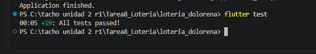

# Lotería Doloreña

Práctica 8: ejercicio guiado de TDD (desarrollo guiado por pruebas) con Flutter.

- Alumno: Oscar Manuel Ayala Ortiz
- N.C. 1225100784, grupo GTID244
- Materia: Desarrollo de Aplicaciones Móviles
- Docente: Anastacio Rodríguez García

## Qué es

Un juego de lotería con 16 cartas de Dolores Hidalgo y la Independencia (El Cura, La Campana, El Grito, La Nieve, etc.). La tabla es de 4x4. El juego va cantando una carta a la vez y la marca solo. Se gana al completar una fila, una columna o una diagonal.

## Imágenes

Cada carta tiene su imagen en `assets/cartas/` (por ejemplo `el_cura.jpg`). La carta calcula la ruta de su imagen con el getter `rutaImagen`, a partir de su nombre. Hay una prueba (`carta_test.dart`) que revisa que ese cálculo sea correcto y que existan las 16 imágenes.

## Cómo se hizo

Seguí el manual paso a paso. En cada ronda hice lo mismo:

1. **Rojo:** escribo una prueba y la corro. Falla porque todavía no existe el código.
2. **Verde:** escribo el código más corto que hace pasar la prueba.
3. **Refactor:** si se puede mejorar, lo arreglo y vuelvo a correr las pruebas.

La lógica del juego está en `lib/logica` y `lib/modelos`. Es Dart puro, sin widgets. La pantalla (`lib/main.dart`) se hizo hasta el final.

## Las 10 rondas

| Ronda | Qué se probó | Archivo |
|-------|--------------|---------|
| 1 | La baraja tiene 16 cartas y no se repite ninguna | `baraja.dart` |
| 2 | Mezclar no pierde ni duplica cartas | `baraja.dart` |
| 3 | Cantar saca una carta del mazo y regresa null cuando se acaban | `baraja.dart` |
| 4 | La tabla tiene las 16 cartas y empieza sin marcas | `tabla.dart` |
| 5 | Marcar una carta de la tabla, y que una carta ajena no haga nada | `tabla.dart` |
| 6 | Detectar una fila completa | `verificador_patrones.dart` |
| 7 | Detectar una columna completa | `verificador_patrones.dart` |
| 8 | Detectar una diagonal completa | `verificador_patrones.dart` |
| 9 | Constructores `desdeCartas` y `desdeFilas` para controlar el orden en las pruebas | `baraja.dart`, `tabla.dart` |
| 10 | El motor junta todo y avisa cuando hay Lotería | `motor_juego.dart` |

Refactor que hice en la ronda 3: cambié `removeAt(0)` por `removeLast()` porque es más rápido y las pruebas siguieron pasando igual.

## Carpetas

```
lib/
  modelos/carta.dart
  logica/baraja.dart
  logica/tabla.dart
  logica/verificador_patrones.dart
  logica/motor_juego.dart
  main.dart
test/
  baraja_test.dart
  carta_test.dart
  tabla_test.dart
  verificador_patrones_test.dart
  motor_juego_test.dart
```

## Cómo correrlo

```
flutter pub get
flutter test
flutter run
```

En la app se toca "Cantar siguiente carta" hasta que salga el aviso de Lotería.

## Evidencia

Resultado de `flutter test` (son 19 pruebas en total: 5 de baraja, 4 de tabla, 6 de patrones, 2 del motor y 2 de la carta):

```
PS C:\tacho unidad 2 r1\Tarea8_Loteria\loteria_dolorena> flutter test
00:05 +19: All tests passed!
```

Captura de la terminal:


